#  UK Departure Board

A UK train departure board for the **Elecrow CrowPanel Basic 7.0" (ESP32-S3, 800x480, touch)**, fed by Home Assistant. It covers National Rail stations and London Underground / DLR stations. You flash it from your browser and set it up with a ready-made automation. You don't need any ESPHome knowledge or YAML.

**Install page:** https://grimmnorth.github.io/departure-board/

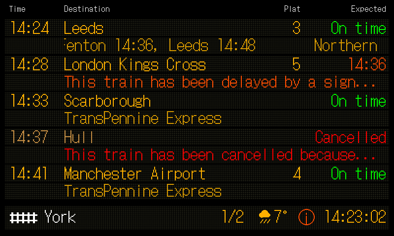

## What you need
- The CrowPanel Basic 7.0"
- Home Assistant 2026.11 or newer
- **My Rail Commute** from the Marketplace (Settings > Marketplace), with a free National Rail Darwin token
- For Tube / DLR only: **London TfL** from the Marketplace

## Setup
1. **Flash.** Open the [install page](https://grimmnorth.github.io/departure-board/) in Chrome or Edge on a computer, plug the board in by USB and click Install.
2. **Wi-Fi.** Enter your Wi-Fi details when the page asks. If it doesn't ask, join the board's `Departure-Board` Wi-Fi from your phone and pick your network.
3. **Add to Home Assistant.** Go to Settings > Devices & services and add the discovered ESPHome device. No key is needed. If it isn't discovered, choose Add integration > ESPHome and enter the board's IP address.
4. **My Rail Commute.** [Install it from the Marketplace](https://my.home-assistant.io/redirect/hacs_repository/?owner=adamf83&repository=my-rail-commute&category=integration), then add your station with **10 services**. Next, open the station's **Configure > Disruption** and set **Departed train grace period** to **1 minute**. With the default of 5, departed trains take up rows.
5. **Connect them.** [Import the blueprint](https://my.home-assistant.io/redirect/blueprint_import/?blueprint_url=https%3A%2F%2Fgithub.com%2FGrimmNorth%2Fdeparture-board%2Fblob%2Fmain%2Fblueprints%2Fautomation%2Fdeparture-board.yaml), then go to Settings > Automations & scenes > Blueprints > UK Departure Board > Create automation. Pick your board and station, then Save. Trains appear within a minute.

You can add up to **5 stations or routes in total** under *More stations or routes*. Tube stations count towards the 5. Updates appear in Home Assistant under Settings > Updates.

### Busy stations: use a route
My Rail Commute sends at most 10 trains. At a big station that may only cover the next 10 minutes. Instead, add your station **with a destination** in My Rail Commute (e.g. Manchester Piccadilly to Leeds). You then get the next 10 trains that go there, and each shows its arrival time (*Arrives 17:39*). Pick the route in the blueprint like a station.

### London Underground and DLR
1. [Install **London TfL** from the Marketplace](https://my.home-assistant.io/redirect/hacs_repository/?owner=morosanmihail&repository=HA-LondonTfL&category=integration) and add your station, with one entry per line.
2. In the blueprint, pick its main sensor under **London Underground / DLR stations**, not the "All" or "Scheduled" one. If you add several lines at one station, they merge into one board.
3. Optional: add Home Assistant's built-in **London Underground** integration. The footer **i** then shows line status when there are problems.

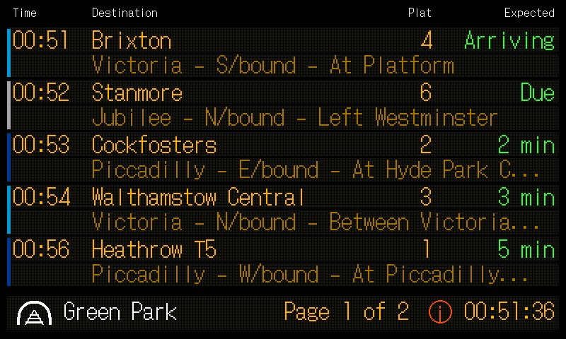

Tube boards always count down and show *Arriving*. Each train has its line, direction and current location, plus a line-colour bar, which you can switch off with *TfL line colours*. TfL doesn't provide delays, cancellations or calling points.

## Using the board

| Do this | To |
|---|---|
| Tap a train | Open its details. Tap left/right (or swipe) for the previous/next train, middle to close |
| Press and hold a train | Make it a favourite (its time is underlined every day) |
| Swipe across the board, or tap the station name | Switch station |
| Tap the clock | Open settings (the last page, *Help*, lists every control) |
| Tap the orange **i** | Read station messages, or Tube line status |
| Tap the orange arrow | See and install a firmware update |

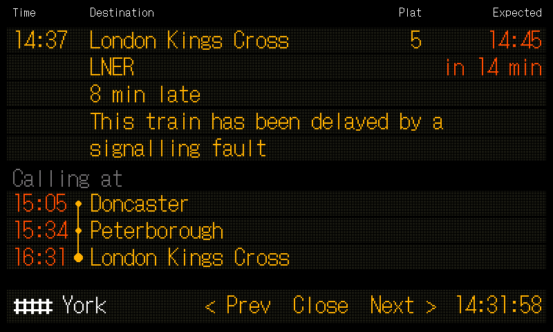 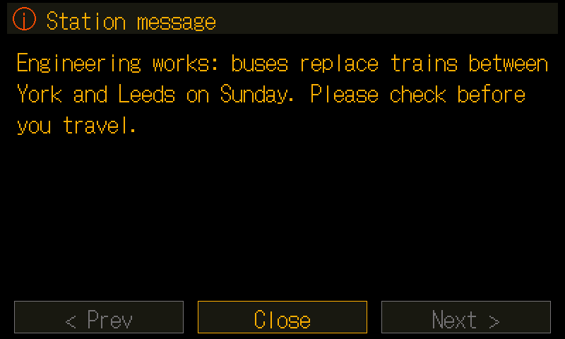

When there are more trains than rows, the board pages between them every 15 seconds (the footer shows *1/2*). A changed platform flashes for a minute. Late in the evening, the final train is labelled *Last train*.

### Weather
Pick a weather entity under **Weather** in the blueprint and the board shows the temperature and an icon in the footer, and beside the date on the clock screen. Switch it off with **Show weather** (in Home Assistant, or *Settings > Extras* on the board).

### Layouts
**Calm** (default): only the first train scrolls its calling points. **Classic**: every train scrolls. **Compact**: one line per train, so 7 or 8 fit.

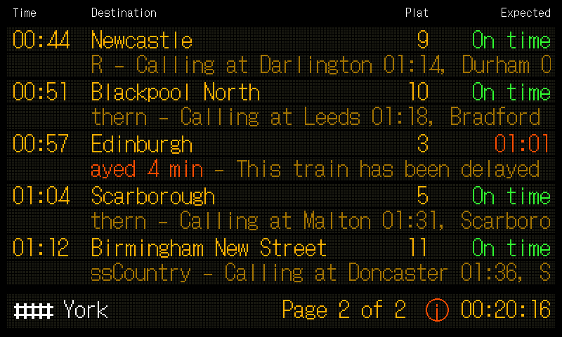 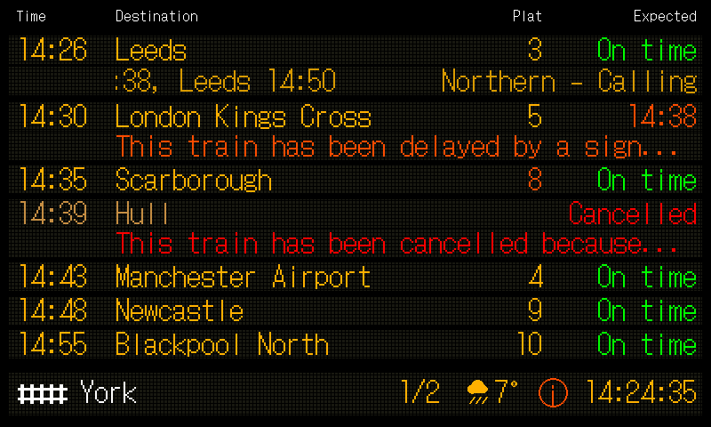

**Focus mode** shows just the next train with a big countdown. If you set a *walking time*, it skips trains you can no longer catch.

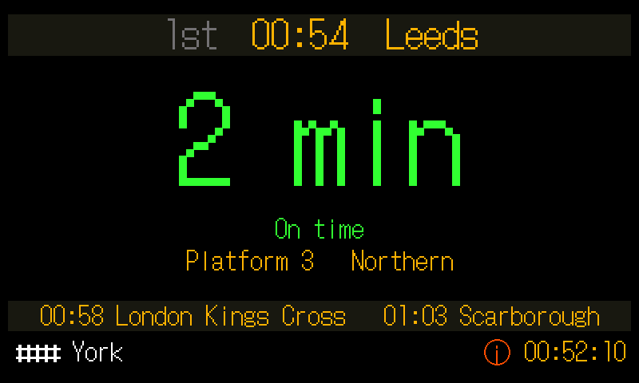 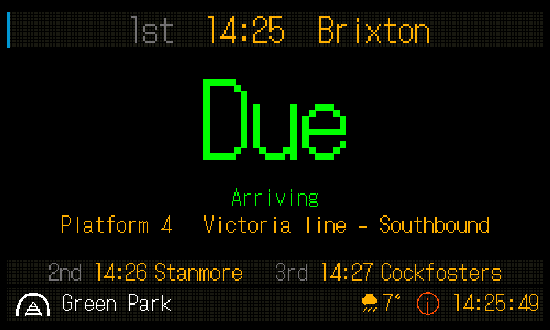

### Themes
Classic amber (default), White LED, Modern LCD, Retro green, High contrast and Daylight. Daylight switches to amber at night.

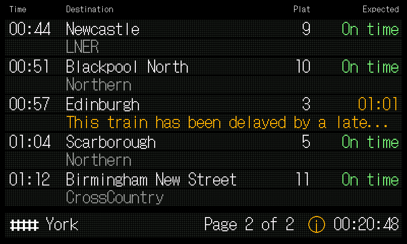 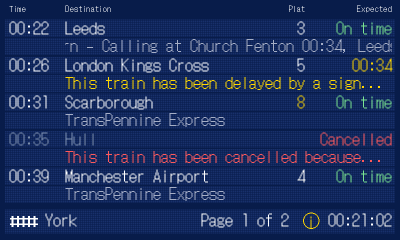 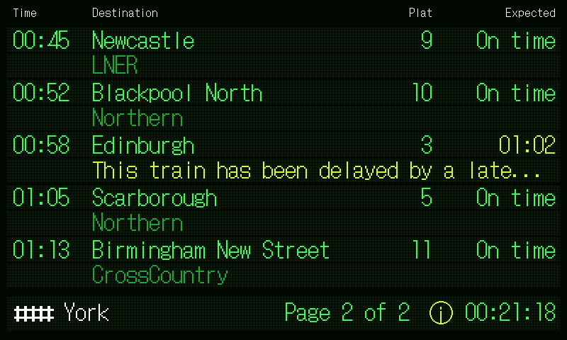
 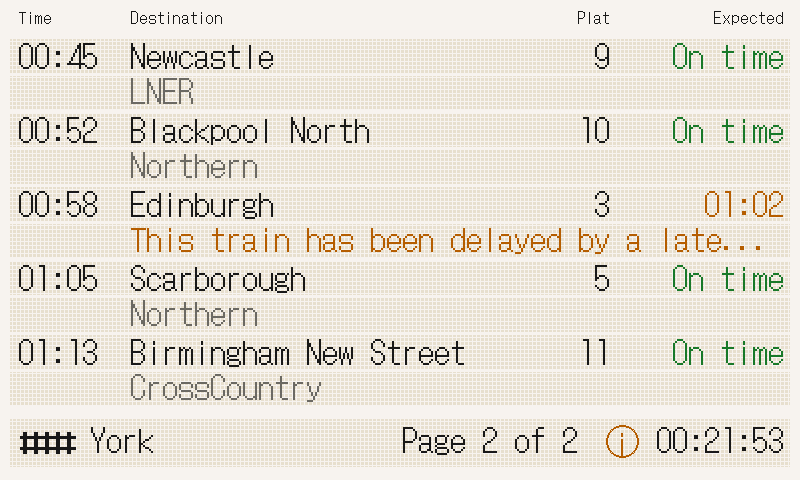

### Settings
Every setting is on the board (tap the clock) and in Home Assistant on the board's device page. Highlights:
- **Display:** theme, layout, text size, scroll speed, clock seconds
- **Trains:** countdown, calling-at filter, hide cancelled, show platform, paging, pin next train, walking time
- **Extras:** highlight a stop, disruption banner, logo, focus mode, clock screen, footer colour, weather
- **Screen:** brightness, night dimming (set times or sunset/sunrise), screen off at night, idle dimming
- **Style:** fade cancelled trains, column headings, page animation, TfL line colours
- **Home Assistant only:** background (*Dot matrix*, *Rows* or *Plain*), page interval, 12-hour clock, demo mode, *Panel colour warmth*, and *Station number* for switching station from your own automations

If the text looks more yellow than amber on your screen, turn up **Panel colour warmth** (new boards start at 18). It only changes the text colours, and screenshots aren't affected.

### Home Assistant dashboard
A ready-made dashboard with every control and setting for your board, using only built-in cards.

The easy way is **Get the dashboard** on the [install page](https://grimmnorth.github.io/departure-board/#dashboard): paste one of your board's entity IDs, click **Copy dashboard**, then paste it into a new dashboard's **Raw configuration editor** (Settings > Dashboards > Add dashboard, open it, pencil, ⋮).

To do it by hand, paste [`dashboard/departure-board.yaml`](dashboard/departure-board.yaml) into the raw editor instead and replace every `departure_board_xxxxxx` with your board's prefix. You'll find the prefix in any of its entity IDs: `select.departure_board_ab12cd_layout` gives `departure_board_ab12cd`.

### Custom logos
The footer shows a track logo on National Rail boards and a tunnel logo on Tube boards. To use your own:
1. Make a PNG about 56 x 35 pixels with a transparent background. It is drawn in the footer colour. On a coloured logo, the coloured parts are filled and the white parts are cut out.
2. Put it in Home Assistant's `/config/www/` folder. For example, `logo.png` becomes `http://<home-assistant-ip>:8123/local/logo.png`.
3. Set **National Rail board logo image** or **TfL board logo image** on the board's device page to that address. Clear it to go back to the built-in logo.

### Demo mode and screenshots
- **Demo mode** (in Home Assistant) shows a made-up York (*National Rail*) or Green Park (*London Underground*) board. Use it to try themes or show the board off. Set it back to *Off* for your own trains.
- **Screenshots:** open `http://<board-ip>/screenshot.png` for an exact copy of the screen. The address is also on the board's *Screenshot* sensor.

## Safety nets
- **Safe mode:** after 5 failed starts, the board boots a minimal mode that can still receive an update over Wi-Fi.
- **Stale data:** the footer turns red ("Data 7 min old") if Home Assistant stops sending trains.
- **Memory watchdog:** if memory runs critically low, the board restarts. If memory is running down slowly, it restarts quietly at 03:30.
- **Automatic updates:** *Install updates automatically* (on by default) installs new versions at about 03:00. Turn it off to update by hand from Settings > Updates or the orange arrow.
- **Update channel:** *Stable* by default. Set it to *Beta* to get test versions first.
- **Factory reset:** a button on the device page clears Wi-Fi and settings, ready to pass the board on.

## Troubleshooting
- **Notifications:** Home Assistant tells you if the board hasn't had trains for 15 minutes, or if My Rail Commute's grace period needs changing. A new board's setup screens also show a QR code to the step you're on.
- **No trains / waiting:** check the automation is on and that you picked the right board and station. To force an update, run it with ⋮ > Run actions.
- **Fewer than 10 trains:** set My Rail Commute's departed train grace period to 1 minute (setup step 4). Quiet stations may simply have fewer trains in the next 2 hours.
- **Board flicks between stations:** you have two automations for one board. Keep one and add the extra stations to it.
- **"No trains calling at ...":** clear the board's *Destination filter* in Home Assistant.
- **No update showing:** the board checks at start-up and every 6 hours. Restart it to check now.

## For the maintainer
The firmware is `firmware/departure-board.yaml` plus `firmware/departure_board.h`, and the blueprint is `blueprints/automation/departure-board.yaml`. Every push to `firmware/` is test-built by **Build check**.

To release, go to **Actions > Release > Run workflow**:
1. Choose **beta**, then enter a version (e.g. `2.0.5`) and a one-line summary. The workflow builds the firmware, publishes it to Beta boards, creates a GitHub Release and adds a `CHANGELOG.md` entry if there isn't one.
2. Test it on a board set to Beta.
3. Run the workflow again with **promote** to release it to everyone.

To upgrade ESPHome, change `ESPHOME_VERSION` in both workflow files. `release.sh` does the publishing by hand if needed.

## Notes
- MIT licence. A hobby project, not affiliated with National Rail, TfL or Elecrow.
- The board's API is unencrypted to keep setup simple, so keep it on your home network.
- Train data comes from National Rail Darwin (via My Rail Commute) and TfL (via London TfL). Check their terms for your use.
- Font: DotGothic16 (SIL Open Font License). `departure_board.h` includes the community USB-pin workaround for the CrowPanel touch bus.
