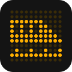
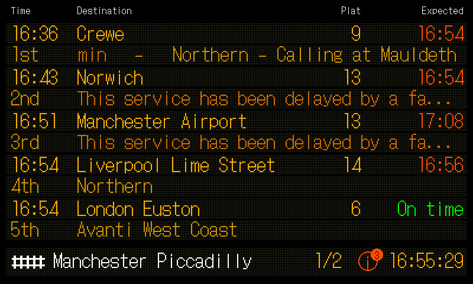

#  UK Departure Board

A live UK train departure board for the **Elecrow CrowPanel Basic 7.0"** (ESP32-S3, 800x480, touch), fed by Home Assistant. National Rail, London Underground and DLR. Install it from your browser and connect it with a ready-made automation: no ESPHome or YAML needed.

🌐 **Install page:** https://grimmnorth.github.io/departure-board/

## 🧰 What you need
- The CrowPanel Basic 7.0" (tested on hardware V3.0, the current version)
- Home Assistant 2026.11 or newer
- **My Rail Commute** from the Marketplace (Settings > Marketplace), with a free National Rail API key from the [Rail Data Marketplace](https://raildata.org.uk/). [My Rail Commute's guide](https://github.com/adamf83/my-rail-commute#national-rail-api-key) shows how to get one
- For Tube / DLR: **London TfL** from the Marketplace
- Optional, for announcements: a speaker you already have in Home Assistant (e.g. a Google Nest Mini, a WiiM or a Sonos)

## 🚀 Setup
1. **Install the firmware.** Open the [install page](https://grimmnorth.github.io/departure-board/) in Chrome or Edge on a computer, plug the board in by USB and click Install.
2. **Wi-Fi.** Enter your Wi-Fi details when asked. If you aren't asked, join the board's `Departure-Board` Wi-Fi from your phone and pick your network.
3. **Add it to Home Assistant.** In Settings > Devices & services, add the discovered ESPHome device (no key needed). Not found? Choose Add integration > ESPHome and enter the board's IP address.
4. **Add your station.** [Install My Rail Commute](https://my.home-assistant.io/redirect/hacs_repository/?owner=adamf83&repository=my-rail-commute&category=integration) and add your station with **10 services**. Then open the station's **Configure > Disruption** and set **Departed train grace period** to **1 minute**.
5. **Connect them.** [Import the blueprint](https://my.home-assistant.io/redirect/blueprint_import/?blueprint_url=https%3A%2F%2Fgithub.com%2FGrimmNorth%2Fdeparture-board%2Fblob%2Fmain%2Fblueprints%2Fautomation%2Fdeparture-board.yaml), then go to Settings > Automations & scenes > Blueprints > UK Departure Board > Create automation. Pick your board and station and save. Trains appear within a minute.

➕ **More stations:** add up to 5 stations or routes in total under *More stations or routes* in the automation (Tube stations count too). Swipe the board to switch.

🚉 **Busy station?** My Rail Commute sends 10 trains, which at a big station may only cover a few minutes. Add the station **with a destination** instead (e.g. Manchester Piccadilly to Leeds) and pick that route. You get the next 10 trains going there, each with its arrival time.

### 🚇 London Underground and DLR
1. [Install **London TfL**](https://my.home-assistant.io/redirect/hacs_repository/?owner=morosanmihail&repository=HA-LondonTfL&category=integration) and add your station, one entry per line.
2. In the automation, pick the station's main sensor under **London Underground / DLR stations** (not "All" or "Scheduled"). Several lines at one station merge into one board.
3. Optional: add Home Assistant's built-in **London Underground** integration so the footer **i** shows line problems.

Tube boards count down and show *Arriving*, with each train's line, direction, location and line colour. TfL doesn't provide delays, cancellations or calling points.

## 👆 Using the board

| Do this | To |
|---|---|
| Tap a train | See its details (tap left/right or swipe for the next train, the middle to close) |
| Press and hold a train | Make it a favourite ❤️ (hold again to remove) |
| Swipe across, or tap the station name | Switch station |
| Tap the clock | Open settings (tap any setting to see what it does) |
| Tap the orange **i** | Read station messages or Tube line status |
| Tap the orange arrow | Install a firmware update |

With more trains than rows, the board pages every 15 seconds (the footer shows *1/2*). A changed platform flashes for a minute.

## 🎨 Make it yours

**Layouts**
- **Calm** (default): only the first train scrolls its calling points
- **Classic:** every train scrolls
- **Compact:** one line per train, so 7 or 8 fit
- **Platform:** like a platform screen: the next train in full, with the 2nd and 3rd underneath. Set *Platform* (under Layout) to show one platform, and *Walking time* to skip trains you can't catch

**Themes:** Classic amber, White LED, Modern LCD, Retro green, High contrast, Split-flap, Airport and Night red.

**❤️ Favourite trains:** press and hold a train to save it as its time and station (e.g. *07:42 York*). You can also type them in **Favourite trains** on the board's device page, comma separated. To get a phone notification when a favourite is late, cancelled or changes platform, pick your phones under **Favourite train alerts** in the automation.

**🌤️ Weather:** pick a weather entity under **Weather** in the automation to show the temperature in the footer and on the clock screen.

### 🔊 Announcements (optional)
Station-style announcements, with a chime first, on a speaker you already have in Home Assistant, such as a Google Nest Mini, a WiiM or a Sonos.

1. **In your automation:** expand **Announcements (optional)** and pick your **Speakers**. You can also pick a voice: Google Translate British by default, or a Piper or Home Assistant Cloud voice.
2. **On the board:** Settings > **Sound** shows the speaker you picked. Set **Announcements** to *All trains*, *Delays only* or *Favourites only*.
3. Press **Test announcement** and set the **Volume** (10% to start with). The speaker is set to this volume just for each announcement, then put back to its own volume.

You can also set *Announce before* (5 minutes), *Chime first* and *Quiet at night* (follows the board's night times). All of these are on the board, its device page in Home Assistant, and the dashboard.

Announcements are for the station on screen (not Tube / DLR), e.g. *"The next train to depart from platform 1 will be the 10:53 Northern service to Leeds"*, or *"We are sorry to announce..."* for delays and cancellations. A train that becomes 5 or more minutes late, or is cancelled, while it's on the board is announced straight away, and a delayed train is announced again shortly before its new time. To stop them for a while, set **Announcements** to *Off*.

### ⚙️ Settings
Every setting is on the board (tap the clock) and on its device page in Home Assistant:
- **Display:** theme, layout, platform or page animation, background, text size, column headings, scrolling speed, train numbers (TfL line colours on Tube boards)
- **Trains:** countdown, calling-at filter, cancelled trains, show platform, paging, pin next train, departed grace, walking time
- **Screen:** brightness, panel warmth, night dimming (set times or sunset/sunrise), night brightness (down to screen off), idle dimming
- **Extras:** highlight a stop, disruption alert, logo, station messages, clock screen, clock format, footer colour, weather
- **Sound:** speaker (picked in the automation), announcements, volume, announce before, chime first, quiet at night, test announcement
- **About:** Wi-Fi, IP address, Home Assistant, data age, firmware, uptime, blueprint, free memory
- **Home Assistant only:** page interval, demo mode, and *Station number* for switching station from your own automations

💡 If the text looks more yellow than amber, turn up **Panel warmth**.

### 📊 Home Assistant dashboard
A ready-made dashboard with every control, using built-in cards only. On the [install page](https://grimmnorth.github.io/departure-board/#dashboard), use **Get the dashboard**: paste one of your board's entity IDs, click **Copy dashboard**, and paste it into a new dashboard's **Raw configuration editor**.

By hand instead

Paste [`dashboard/departure-board.yaml`](dashboard/departure-board.yaml) into the raw editor and replace every `departure_board_xxxxxx` with your board's prefix, which is in any of its entity IDs: `select.departure_board_ab12cd_layout` gives `departure_board_ab12cd`.

Custom logos

1. Make a PNG about 56 x 35 pixels with a transparent background. It's drawn in the footer colour.
2. Put it in Home Assistant's `/config/www/` folder: `logo.png` is then at `http://<home-assistant-ip>:8123/local/logo.png`.
3. Set **National Rail board logo image** or **TfL board logo image** on the board's device page to that address. Clear it for the built-in logo.

Demo mode and screenshots

- **Demo mode** (in Home Assistant) shows a made-up York or Green Park board. Set it back to *Off* for your own trains.
- **Screenshots:** open `http://<board-ip>/screenshot.png` (also on the board's *Screenshot* sensor).

## 🔄 Updates
- **Firmware** updates itself at about 03:00 (*Install updates automatically*). Turn that off to update by hand from Settings > Updates or the orange arrow. Set *Update channel* to *Beta* for test versions.
- **The blueprint** doesn't update itself. When a release needs the new one, the board's About page and *Blueprint* sensor say so. To update: Settings > Automations & scenes > Blueprints > UK Departure Board > ⋮ > Re-import blueprint. Your settings are kept.

🛟 **Safety nets:** the footer turns red ("Data 7 min old") if trains stop arriving; after 5 failed starts the board starts in safe mode, which can still take an update; it restarts itself if memory runs low; and a **Factory reset** button on the device page clears Wi-Fi and settings.

## 🩺 Troubleshooting
- **Notifications:** Home Assistant tells you if the board hasn't had trains for 15 minutes, or if the grace period needs changing. They clear themselves once fixed.
- **No trains, or "Waiting":** check the automation is on and has the right board and station. Open it and choose ⋮ > Run actions to force an update.
- **Fewer than 10 trains:** check the grace period is 1 minute (setup step 4). Quiet stations may just have fewer trains.
- **Board flicks between stations:** you have two automations for one board. Keep one and add the stations to it.
- **"No trains calling at ...":** clear the board's *Destination filter* in Home Assistant.
- **No update showing:** the board checks at start-up and every 6 hours. Restart it to check now.

For the maintainer

The firmware is `firmware/departure-board.yaml` plus `firmware/departure_board.h`; the blueprint is `blueprints/automation/departure-board.yaml`. Every push to `firmware/` is test-built by **Build check**.

To release, go to **Actions > Release > Run workflow**: choose **beta** with a version and a one-line summary, test it on a Beta board, then run it again with **promote** for everyone. To upgrade ESPHome, change `ESPHOME_VERSION` in both workflow files. `release.sh` publishes by hand if needed.

## 💡 Ideas for the future
Things that might come next. Nothing here is promised, and suggestions are welcome: [open an issue](https://github.com/GrimmNorth/departure-board/issues).

- **A 3D-printed case:** a platform-style frame that stands on a desk or hangs on the wall. Being test printed now.
- **Arrivals mode:** show trains arriving at the station, not just departing.
- **Next train home:** a journey view for a set route, including a change of train.
- **More rail networks:** trams, metros and underground systems beyond London (e.g. Metrolink, Tyne and Wear Metro, Glasgow Subway), wherever a Home Assistant integration provides the times.
- **More screens:** other CrowPanel sizes (5", the 7" Advance) and similar ESP32 displays.
- **Automatic brightness:** dim and brighten with the room, using a light sensor.
- **Explore a standalone mode:** see whether the board can get the trains straight from National Rail, with no Home Assistant needed.

## 🙏 Thanks
This board wouldn't work without two Home Assistant integrations, which do the hard work of fetching the trains:

- **[My Rail Commute](https://github.com/adamf83/my-rail-commute)** by adamf83: National Rail departures, delays, cancellations and platforms.
- **[London TfL](https://github.com/morosanmihail/HA-LondonTfL)** by morosanmihail: Tube, DLR and other TfL departures.

Thanks also to **[Elecrow](https://www.elecrow.com/)** for the CrowPanel 7.0" HMI ESP32 display (DIS08070H) this runs on. Their [GitHub repo for the board](https://github.com/Elecrow-RD/CrowPanel-7.0-HMI-ESP32-Display-800x480) and [wiki](https://www.elecrow.com/wiki/esp32-display-702727-intelligent-touch-screen-wi-fi26ble-800480-hmi-display.html) have the pinouts and schematics the firmware is built on.

If you find this project useful, consider starring their repos too.

## 📝 Notes
- MIT licence. A hobby project, not affiliated with National Rail, TfL or Elecrow.
- The board's API is unencrypted to keep setup simple, so keep it on your home network.
- Train data comes from National Rail Darwin (via My Rail Commute) and TfL (via London TfL). Check their terms for your use.
- Font: DotGothic16 (SIL Open Font License). `departure_board.h` includes the community USB-pin workaround for the CrowPanel touch bus.
