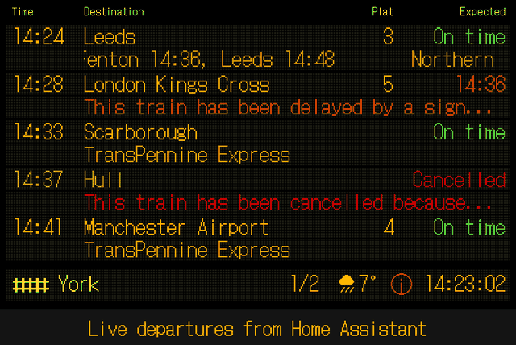
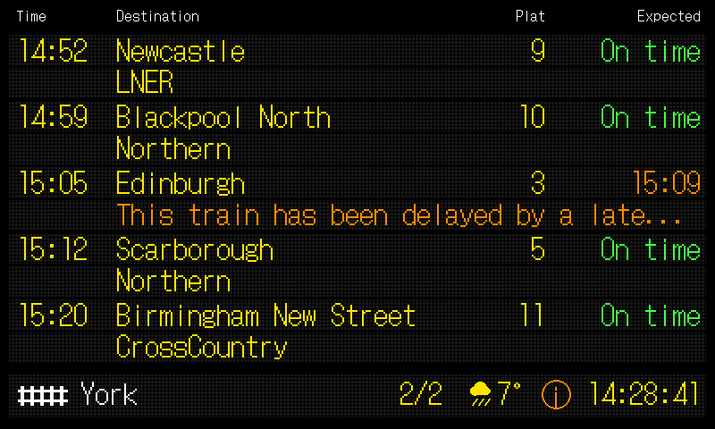

#  UK Departure Board

A live UK train departure board for the **Elecrow CrowPanel Basic 7.0" (ESP32-S3, 800x480, touch)**, fed by Home Assistant. It covers National Rail, London Underground and DLR. You install it from your browser and connect it with a ready-made automation, so you don't need to know ESPHome or YAML.

**Install page:** https://grimmnorth.github.io/departure-board/

## What you need
- The CrowPanel Basic 7.0" (tested on hardware V3.0, the current version)
- Home Assistant 2026.11 or newer
- **My Rail Commute** from the Marketplace (Settings > Marketplace), with a free National Rail Darwin token
- For Tube / DLR only: **London TfL** from the Marketplace
- Optional, for sound and announcements: a small speaker plugged into the board's speaker socket (not included with the board)

## Setup
1. **Install the firmware.** Open the [install page](https://grimmnorth.github.io/departure-board/) in Chrome or Edge on a computer, plug the board in by USB and click Install.
2. **Wi-Fi.** Enter your Wi-Fi details when the page asks. If it doesn't ask, join the board's `Departure-Board` Wi-Fi from your phone and pick your network.
3. **Add it to Home Assistant.** In Settings > Devices & services, add the discovered ESPHome device (no key needed). If it isn't found, choose Add integration > ESPHome and enter the board's IP address.
4. **Add your station.** [Install My Rail Commute](https://my.home-assistant.io/redirect/hacs_repository/?owner=adamf83&repository=my-rail-commute&category=integration) and add your station with **10 services**. Then open the station's **Configure > Disruption** and set **Departed train grace period** to **1 minute**, so trains that have left don't take up rows.
5. **Connect them.** [Import the blueprint](https://my.home-assistant.io/redirect/blueprint_import/?blueprint_url=https%3A%2F%2Fgithub.com%2FGrimmNorth%2Fdeparture-board%2Fblob%2Fmain%2Fblueprints%2Fautomation%2Fdeparture-board.yaml), then go to Settings > Automations & scenes > Blueprints > UK Departure Board > Create automation. Pick your board and station, then Save. Trains appear within a minute.

**More stations:** add up to 5 stations or routes in total under *More stations or routes* in the blueprint (Tube stations count towards the 5). Swipe the board to switch.

### Busy stations: use a route
My Rail Commute sends at most 10 trains, which at a big station may only cover the next 10 minutes. Add your station **with a destination** instead (e.g. Manchester Piccadilly to Leeds) and pick that route in the blueprint. You get the next 10 trains going there, each with its arrival time (*Arrives 17:39*).

### London Underground and DLR
1. [Install **London TfL**](https://my.home-assistant.io/redirect/hacs_repository/?owner=morosanmihail&repository=HA-LondonTfL&category=integration) and add your station, one entry per line.
2. In the blueprint, pick the station's main sensor under **London Underground / DLR stations** (not the "All" or "Scheduled" one). Several lines at one station merge into one board.
3. Optional: add Home Assistant's built-in **London Underground** integration, so the footer **i** shows line problems.

Tube boards count down and show *Arriving*, with each train's line, direction, current location and line colour (switch the colour off with *TfL line colours*). TfL doesn't provide delays, cancellations or calling points.

## Using the board

| Do this | To |
|---|---|
| Tap a train | Open its details. Tap left/right (or swipe) for the previous/next train, the middle to close |
| Press and hold a train | Make it a favourite: a heart shows under its time every day at that station. Hold it again to remove it |
| Swipe across the board, or tap the station name | Switch station |
| Tap the clock | Open settings (tap any setting to see what it does; the last page, *About*, shows the board's status) |
| Tap the orange **i** | Read station messages or Tube line status |
| Tap the orange arrow | Install a firmware update |

 

With more trains than rows, the board pages every 15 seconds (the footer shows *1/2*). A changed platform flashes for a minute.

## Make it yours

### Layouts
**Calm** (default): only the first train scrolls its calling points. **Classic**: every train scrolls. **Compact**: one line per train, so 7 or 8 fit. **Platform**: like the screens on a platform: the next train in full (platform, train company, a reason if it's late, and every stop with its time), with the 2nd and 3rd trains taking turns underneath. Set *Platform* (right under Layout on the board's Display page) to show only one platform's trains; set a *walking time* and it skips trains you can no longer catch.

 

### Themes
Classic amber (default), White LED, Modern LCD, Retro green, High contrast, Split-flap (white on grey flaps, like the old Solari boards), Airport (yellow on charcoal) and Night red (dim red, gentle in a bedroom at night).

  

### Favourite trains
Press and hold a train to make it a favourite. It's saved as its time and station (e.g. *07:42 Brough*) in **Favourite trains** on the board's device page, where you can also type them, separated by commas. A time without a station counts at every station.

To get a phone notification when a favourite is late, cancelled or changes platform, pick your phones (Home Assistant Companion app) under **Favourite train alerts** in the blueprint. You choose how late counts (5 minutes by default) and whether to include platform changes. A train only alerts again if it gets worse.

### Sound (optional)
Sound needs a speaker plugged into the board's speaker socket (a small 4-8 ohm speaker of about 2-3 W). The board doesn't come with one, and without one these settings do nothing.
- **On the board:** settings has a **Sound** page: *Sounds* on or off, *Volume*, *Announcements* (*Off*, *All trains*, *Delays only* or *Favourites only*), *Announce before* (5 minutes by default), *Chime first*, *Quiet at night* (silent between the board's Night starts and Night ends, or sunset to sunrise) and *Test sound*. The same settings are on the board's device page in Home Assistant.
- **Announcements:** station-style, for the station or route the board is showing (not Tube / DLR), e.g. *"The next train to depart from platform 1 will be the 10:53 Northern service to Hull"*, or *"We are sorry to announce..."* when a train is delayed or cancelled. Home Assistant does the speaking, using Google Translate (free, built in) unless you choose another voice.
- **Voice and other speakers (optional):** in your departure board automation (Settings > Automations & scenes), expand **Announcement voice and speakers** to pick a voice service (e.g. Piper or Home Assistant Cloud), a voice, or other speakers to announce on too.
- **Footer:** a speaker icon shows only while the board is speaking (amber; tap it to stop) or when sound is off (grey with a cross; tap it to turn sound back on).
- You can also play your own announcements to the board's *Speaker* media player with `tts.speak`.

### Weather
Pick a weather entity under **Weather** in the blueprint to show the temperature and an icon in the footer and on the clock screen. Hide it with **Show weather**.

### Settings
Every setting is on the board (tap the clock) and on the board's device page in Home Assistant:
- **Display:** theme, layout, page animation (or *Platform*, when Layout is Platform), background (*Dot matrix*, *Rows* or *Plain*), text size, column headings, scrolling text speed, train numbers (TfL line colours on Tube boards)
- **Trains:** countdown, calling-at filter, cancelled trains (shown, faded or hidden), show platform, paging, pin next train, departed grace, walking time
- **Screen:** brightness, panel colour warmth, night dimming (set times or sunset/sunrise), night brightness (down to screen off), idle dimming
- **Extras:** highlight a stop, disruption alert, logo, station messages, clock screen, 12/24-hour clock and seconds, footer colour, weather
- **Sound** (needs a speaker plugged in): sounds on or off, volume, announcements, announce before, chime first, quiet at night, test sound
- **About:** Wi-Fi, IP address, Home Assistant link, data age, firmware, uptime, ESPHome version, free memory
- **Home Assistant only:** page interval, demo mode, and *Station number* for switching station from your own automations

If the text looks more yellow than amber, turn up **Panel colour warmth** (new boards start at 18). It only changes the screen, not screenshots.

### Home Assistant dashboard
A ready-made dashboard with every control and setting, using only built-in cards. Use **Get the dashboard** on the [install page](https://grimmnorth.github.io/departure-board/#dashboard): paste one of your board's entity IDs, click **Copy dashboard**, and paste the result into a new dashboard's **Raw configuration editor**.

By hand instead

Paste [`dashboard/departure-board.yaml`](dashboard/departure-board.yaml) into the raw editor and replace every `departure_board_xxxxxx` with your board's prefix, which is in any of its entity IDs: `select.departure_board_ab12cd_layout` gives `departure_board_ab12cd`.

Custom logos

The footer shows a track logo on National Rail boards and a tunnel logo on Tube boards. To use your own:
1. Make a PNG about 56 x 35 pixels with a transparent background. It's drawn in the footer colour: on a coloured logo, the coloured parts are filled and the white parts cut out.
2. Put it in Home Assistant's `/config/www/` folder. `logo.png` then lives at `http://<home-assistant-ip>:8123/local/logo.png`.
3. Set **National Rail board logo image** or **TfL board logo image** on the board's device page to that address. Clear it to go back to the built-in logo.

Demo mode and screenshots

- **Demo mode** (in Home Assistant) shows a made-up York (*National Rail*) or Green Park (*London Underground*) board, for trying themes or showing it off. Set it back to *Off* for your own trains.
- **Screenshots:** open `http://<board-ip>/screenshot.png` for an exact copy of the screen. The address is also on the board's *Screenshot* sensor.

## Updates and safety nets
- **Updates** install themselves at about 03:00 (*Install updates automatically*, on by default). Turn it off to update by hand from Settings > Updates or the orange arrow. Set *Update channel* to *Beta* to get test versions first.
- **The blueprint doesn't update itself.** Home Assistant keeps the copy you imported. When a release needs the new one, the board's About page and its *Blueprint* sensor say "Update available", and the changelog says what you'd get. To update: Settings > Automations & scenes > Blueprints > UK Departure Board > ⋮ > Re-import blueprint. Your automation keeps its settings.
- **Stale data:** the footer turns red ("Data 7 min old") if Home Assistant stops sending trains.
- **Safe mode:** after 5 failed starts, the board starts a minimal mode that can still receive an update over Wi-Fi.
- **Memory watchdog:** the board restarts if memory runs critically low, or quietly at 03:30 if it's running down slowly.
- **Factory reset:** a button on the device page clears Wi-Fi and settings, ready to pass the board on.

## Troubleshooting
- **Notifications:** Home Assistant tells you if the board hasn't had trains for 15 minutes, or if My Rail Commute's grace period needs changing. They clear themselves once it's fixed. A new board's setup screens also show a QR code for the step you're on.
- **No trains, or "Waiting":** check the automation is on and has the right board and station. To force an update, open it and choose ⋮ > Run actions.
- **Fewer than 10 trains:** check the grace period is 1 minute (setup step 4). Quiet stations may just have fewer trains in the next 2 hours.
- **Board flicks between stations:** you have two automations for one board. Keep one and add the extra stations to it.
- **"No trains calling at ...":** clear the board's *Destination filter* in Home Assistant.
- **No update showing:** the board checks at start-up and every 6 hours. Restart it to check now.

For the maintainer

The firmware is `firmware/departure-board.yaml` plus `firmware/departure_board.h`, and the blueprint is `blueprints/automation/departure-board.yaml`. Every push to `firmware/` is test-built by **Build check**.

To release, go to **Actions > Release > Run workflow**:
1. Choose **beta**, enter a version (e.g. `2.0.5`) and a one-line summary. The workflow builds the firmware, publishes it to Beta boards, creates a GitHub Release and adds a `CHANGELOG.md` entry if there isn't one.
2. Test it on a board set to Beta.
3. Run the workflow again with **promote** to release it to everyone.

To upgrade ESPHome, change `ESPHOME_VERSION` in both workflow files. `release.sh` does the publishing by hand if needed.

## Notes
- MIT licence. A hobby project, not affiliated with National Rail, TfL or Elecrow.
- The board's API is unencrypted to keep setup simple, so keep it on your home network.
- Train data comes from National Rail Darwin (via My Rail Commute) and TfL (via London TfL). Check their terms for your use.
- Font: DotGothic16 (SIL Open Font License). `departure_board.h` includes the community USB-pin workaround for the CrowPanel touch bus.
